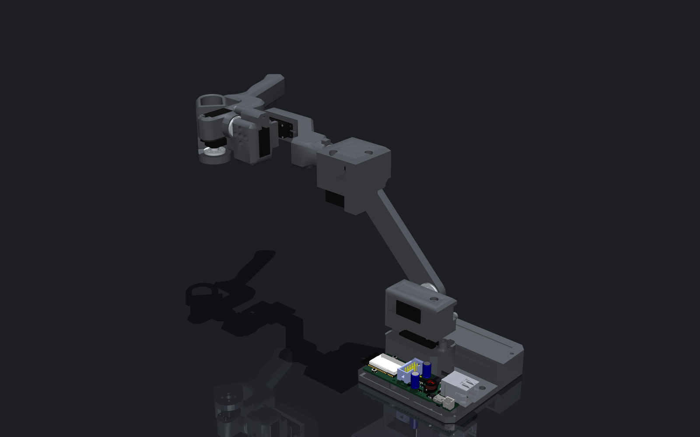

> [!CAUTION]
> The arm is still in progress and no code has been developed for it!
>

# RAFT-teleoperation-arm
Robot arm force feedback teleopretion system

     

  
  
  
  
  
  

## 📖 Project Overview

RAFT is a compact teleoperation arm designed to control [PAR6]() and [PAROL6]() robots. It features integrated force feedback, allowing the operator to feel the forces experienced by the remote robot in real time.
By size it is a scaled version of PAR6.

## ⚒️How to build ?

If you want to Source all the parts yourself and build your own follow these steps:

* Print files from the STEP files
* Get all the parts from the BOM
* Assemble the robot

## 📚BOM

## 📚Documentation

xxx

## 🌐 More about our projects 

| YouTube | Instagram | Twitter | LinkedIn |
|--------|-----------|---------|----------|
|  |  |  |  |

| Discord | Forum | Hackaday | Blog |
|--------|-------|------| ------|
|  |  |  |  

## ⚠️ Safety, Liability & Disclaimer
This project includes experimental software, hardware designs, and assembly documentation that are still under development and may contain bugs, errors, or incomplete features. By using, building, or modifying this project, you acknowledge that:

* You use this project entirely at your own risk
* You are solely responsible for safe assembly, testing, and operation
* No guarantee is made regarding correctness, safety, or reliability
* The authors are not responsible for any damage, injury, or loss resulting from the use or misuse of this project
* Hardware performance and safety depend on user assembly, component quality, calibration, and handling, which cannot be guaranteed
* This project is provided “as is.” If you choose to build a device yourself using these files, designs, or instructions, you do so without any warranties or guarantees, including regarding safety, reliability, or suitability for any particular purpose.

THIS PROJECT INVOLVES LETHAL VOLTAGES AND OTHER SERIOUS HAZARDS THAT CAN CAUSE SEVERE INJURY. YOU MUST READ THE FULL [SAFETY WARNING AND DISCLAIMER DOCUMENT](SAFETY_WARNING_AND_DISCLAIMER.md)  BEFORE USING ANY PROJECT FILES. BY PROCEEDING, YOU ACKNOWLEDGE AND ACCEPT ALL RISKS AND AGREE TO USE THIS PROJECT ENTIRELY AT YOUR OWN RESPONSIBILITY.

## 🛡️ Licensing
 Project is under [CERN Open Hardware Licence Version 2 - Strongly Reciprocal](https://github.com/Source-Robotics/RAFT-teleoperation-arm?tab=CERN-OHL-S-2.0-1-ov-file)