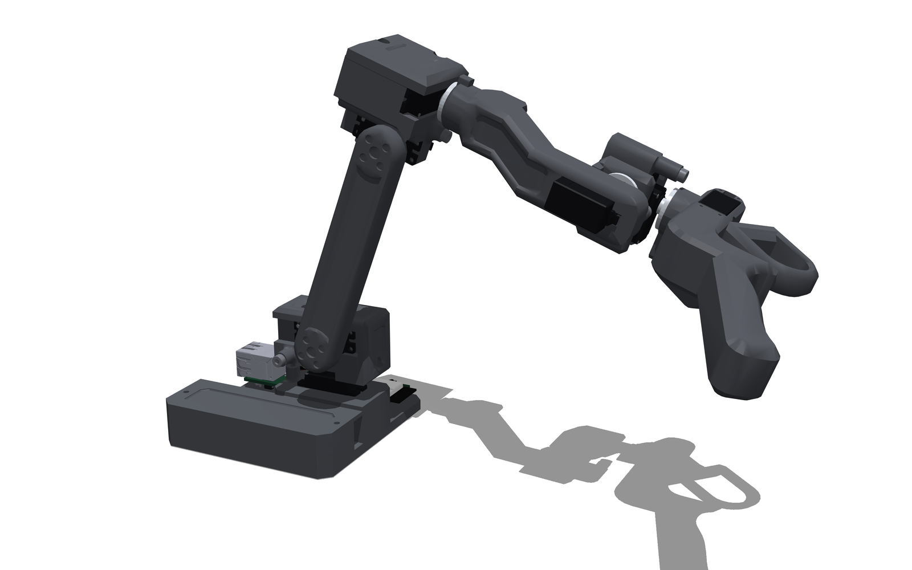
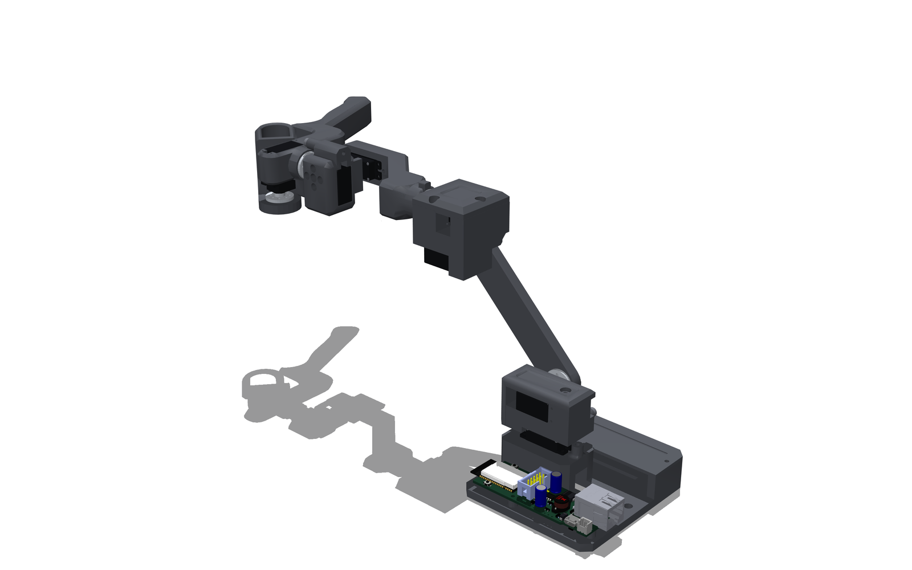
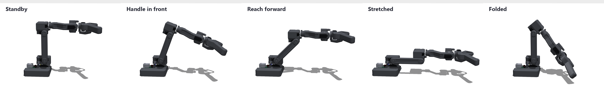

> [!NOTE]
> Version 1.0.0 ([changelog](CHANGELOG.md)). The firmware runs on the first arm: gravity compensation, calibration
> at the mechanical stops, the web UI. Teleoperation of PAR6 is tested in simulation and against the RCB runtime's
> protocol, not yet on the real robot.


<div align="center">

# RAFT-teleoperation-arm
Robot arm force feedback teleoperation system

[](LICENSE)
[](LICENSE-GPL-3.0)
    
<p align="center">
  <a href="https://docs.source-robotics.com/PAROL-docs/"></a>
  <a href="http://discord.gg/prjUvjmGpZ"></a>
  <a href="https://source-robotics.com/"></a>
  <a href="https://www.linkedin.com/company/source-robotics/"></a>
  <a href="https://x.com/SourceRobotics"></a>
  <a href="https://www.youtube.com/@source-robotics"></a>
</p>


</div>


## 📖 Project Overview

RAFT is a compact teleoperation arm designed to control [PAR6](https://github.com/Source-Robotics/PAR6-Collaborative-Robot-Arm) and [PAROL6](https://github.com/Source-Robotics/PAROL6-Desktop-robot-arm) robots. It features integrated force feedback, allowing the operator to feel the forces experienced by the remote robot in real time.
By size it is a scaled version of PAR6.

Seven Feetech HLS3606 serial servos drive its six joints and the trigger, in current (torque) mode. An Olimex
ESP32-PoE runs everything on board, with no PC in the loop:
- **Gravity compensation:** the arm floats in the hand, with friction compensation for the servos' gears and damping
  on the wrist.
- **Calibration at the mechanical stops:** push each joint against its stop once; the zeros survive power-offs.
- **Web UI** on the arm itself: a 3D view of the real arm, joints, calibration, teleoperation, health, settings.
- **Bilateral teleoperation** of PAR6 through its RCB runtime: PAR6 follows the hand, and the hand feels where PAR6
  really is (a blocked PAR6 holds the arm back), with optional contact force feedback, haptic walls at the joint
  limits and a clutch.
- **Over-the-network updates** when the board runs on PoE.

## 🖼️ Gallery

<p align="center">
<picture>
  <source media="(prefers-color-scheme: dark)" srcset="Photos/render_hero_dark.png">
  
</picture>
<picture>
  <source media="(prefers-color-scheme: dark)" srcset="Photos/render_back_dark.png">
  
</picture>
</p>

<p align="center">
<picture>
  <source media="(prefers-color-scheme: dark)" srcset="Photos/render_poses_dark.png">
  
</picture>
</p>

Rendered from the arm's MuJoCo model (`raft_description/`) by [`tools/render_gallery.py`](tools/render_gallery.py).

## 📁 What is in here

| Folder / file | Contents |
|---|---|
| [`STEP files/`](STEP%20files/), [`3D print files/`](3D%20print%20files/) | The parts, as STEP and as ready-to-print bundles |
| [`BOM.md`](BOM.md) | Bill of materials: servos, screws, electronics, the optional J2 spring |
| [`Assembly manual/`](Assembly%20manual/) | Assembly, step by step: which servo goes where, wiring |
| [`firmware/`](firmware/) | ESP32 firmware (PlatformIO, C++), web UI, host tests and simulators, documentation |
| [`raft_description/`](raft_description/) | URDF, xacro and MuJoCo models with meshes, ROS 2 display launch |
| [`examples/`](examples/) | `gravity_comp.py`: the arm floating in MuJoCo |
| [`tools/`](tools/) | `check_description.py` (runs in CI), `render_media.py`, `render_assembly.py` (the assembly pictures), `render_gallery.py` (the pictures above) |
| [`datasheets/`](datasheets/) | ESP32-PoE, HLS3606, TTLinker |

## ⚒️How to build ?

To source the parts and build your own:

* Print the parts: the ready-to-print bundles are in [`3D print files/`](3D%20print%20files/), the STEP files in
  [`STEP files/`](STEP%20files/)
* Get the rest from the [BOM](BOM.md)
* Assemble the robot: [`Assembly manual/readme.md`](Assembly%20manual/readme.md)
* Wire it and bring it up step by step: [`firmware/docs/bringup.md`](firmware/docs/bringup.md) (wiring, servo IDs,
  flashing, calibration at the stops, first torque)

## 📚BOM

See [`BOM.md`](BOM.md).

## 📚Documentation

| | |
|---|---|
| [Bring-up guide](firmware/docs/bringup.md) | From loose parts to teleoperating PAR6, one checked step at a time |
| [Calibration](firmware/docs/calibration.md) | Zeros at the stops, what is stored where, torque sweeps |
| [Web UI](firmware/docs/web_ui.md) | The page on the arm, and the simulator to try it on a PC |
| [Protocol](firmware/docs/teleop_protocol.md) | Commands (TCP 5000, web socket), the leader frame stream, teleoperation |
| [PAR6 link test](firmware/docs/rcb_link_test.md) | Checking the link to PAR6's RCB runtime before the arm moves anything |
| [J2 spring](firmware/docs/spring_mount.md) | The optional counterbalance for the shoulder |
| [Firmware](firmware/README.md) | Building, flashing over USB or the network, tests |
| [Robot description](raft_description/README.md) | URDF, xacro, MuJoCo, ROS 2 |
| [Changelog](CHANGELOG.md) | What each version changed |

Try the model without hardware:

```bash
pip install mujoco
python -m mujoco.viewer --mjcf=raft_description/mjcf/scene.xml
python examples/gravity_comp.py
```

## Specifications

| | |
|---|---|
| Joints | 6 + trigger, all actuated |
| Geometry | PAR6 (PAROL6) kinematics, CM6 DH table, scaled to about 0.55× |
| TCP at the standby pose | 189 mm forward, 175 mm up from the base plate |
| Horizontal reach (arm stretched) | 289 mm to the TCP |
| Mass | 371 g in total, 284 g moving |
| Actuators | 7 × Feetech HLS3606 (6 kg·cm stall at 6 V, 1:205, 12-bit absolute encoder), current mode |
| Bus | one half-duplex serial bus at 1 Mbit/s |
| Controller | Olimex ESP32-PoE: 250 Hz control loop, Ethernet with PoE, web UI, OTA updates |
| J2 counterbalance | optional zero-free-length cable spring |

## 🌐 More about our projects 

| YouTube | Instagram | Twitter | LinkedIn |
|--------|-----------|---------|----------|
| [](https://www.youtube.com/@source-robotics) | [](https://www.instagram.com/source_robotics/) | [](https://twitter.com/SourceRobotics) | [](https://www.linkedin.com/company/source-robotics) |


| Discord | Forum | Hackaday | Blog |
|--------|-------|------| ------|
| [](https://discord.com/invite/prjUvjmGpZ) | [](https://github.com/orgs/Source-Robotics/discussions) | [](https://hackaday.io/project/191860-parol6-desktop-robotic-arm) | [](https://source-robotics.com/blogs/blog) 


## 📜 Licensing

| What | Licence |
|---|---|
| Hardware: STEP and 3D print files, the robot description (`raft_description/`), BOM, photos | [CERN-OHL-S-2.0](LICENSE) |
| Software: `firmware/`, `tools/`, `examples/` | [GPL-3.0](LICENSE-GPL-3.0) |
| The Feetech servo driver bundled in `firmware/src/` (`HLSCL`, `SCS`, `SCSCL`, `SMS_STS`, `SCSerial`, `INST.h`, `SCServo.h`), from [FTServo_Arduino](https://github.com/ftservo/FTServo_Arduino), unchanged | [MIT](firmware/src/LICENSE-FTServo.txt), © 2024 ftservo |
| The pictures in `BOM reference images/` (vendor photos and Wikimedia Commons) | Each its own, listed in [`BOM reference images/README.md`](BOM%20reference%20images/README.md) |

RAFT's kinematics follow the PAROL6 / PAR6 arm by Source Robotics; the force-feedback leader idea comes from FACTR.

## ⚠️ Safety, Liability & Disclaimer
This project includes experimental software, hardware designs, and assembly documentation that are still under development and may contain bugs, errors, or incomplete features. By using, building, or modifying this project, you acknowledge that:

* You use this project entirely at your own risk
* You are solely responsible for safe assembly, testing, and operation
* No guarantee is made regarding correctness, safety, or reliability
* The authors are not responsible for any damage, injury, or loss resulting from the use or misuse of this project
* Hardware performance and safety depend on user assembly, component quality, calibration, and handling, which cannot be guaranteed
* This project is provided “as is.” If you choose to build a device yourself using these files, designs, or instructions, you do so without any warranties or guarantees, including regarding safety, reliability, or suitability for any particular purpose.

RAFT MOVES BY ITSELF UNDER SOFTWARE CONTROL, AND IN TELEOPERATION IT MOVES PAR6, A LARGER ROBOT THAT CAN CAUSE SEVERE INJURY. YOU MUST READ THE FULL [SAFETY WARNING AND DISCLAIMER DOCUMENT](SAFETY_WARNING_AND_DISCLAIMER.md) BEFORE USING ANY PROJECT FILES. BY PROCEEDING, YOU ACKNOWLEDGE AND ACCEPT ALL RISKS AND AGREE TO USE THIS PROJECT ENTIRELY AT YOUR OWN RESPONSIBILITY.
