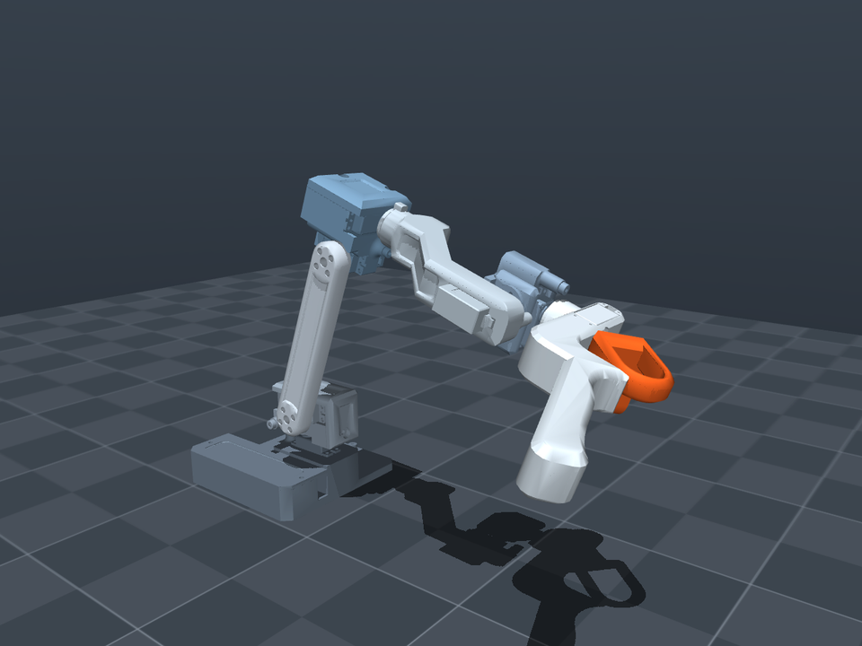
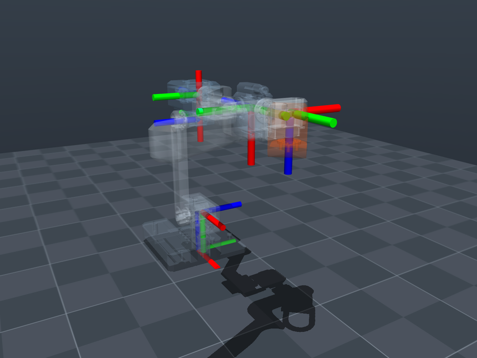
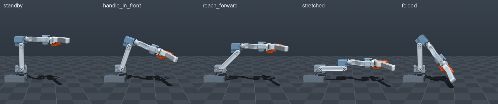

# raft_description

URDF, xacro and MuJoCo models of the RAFT leader arm. RAFT has six joints plus a trigger, and its geometry is the PAR6 (PAROL6) arm scaled to about 0.55×.



All three files describe the same robot with the same numbers. `tools/check_description.py` proves that they agree with each other and with the DH table below.

| File | What it is |
|---|---|
| `urdf/raft.urdf` | Plain URDF. Mesh paths are `package://raft_description/...`. MuJoCo can load it directly. |
| `urdf/raft.urdf.xacro` | The same robot through xacro, with an optional `prefix` argument. |
| `urdf/raft_macro.xacro` | The macro `raft(prefix, parent, xyz, rpy)`, for scenes with more than one robot. |
| `mjcf/raft.xml` | MuJoCo model: inertials, torque motors, collision hulls, J2 spring tendon, keyframes. |
| `mjcf/scene.xml` | `raft.xml` with a floor (the table), lights and a camera setup. |
| `meshes/*.stl` | One visual mesh per link, in metres, used by every file above. |
| `launch/display.launch.py`, `rviz/display.rviz` | ROS 2: the arm in RViz with joint sliders. |

## Use it

**MuJoCo**

```bash
pip install mujoco
python -m mujoco.viewer --mjcf=raft_description/mjcf/scene.xml
python examples/gravity_comp.py              # the arm floats, as on the real ESP32
```

**ROS 2** (copy or link this folder into a workspace's `src/`)

```bash
colcon build --packages-select raft_description
source install/setup.bash
ros2 launch raft_description display.launch.py
```

**RAFT next to another robot**

```xml
<xacro:include filename="$(find raft_description)/urdf/raft_macro.xacro"/>
<xacro:raft prefix="leader_" parent="world" xyz="0.5 0 0" rpy="0 0 3.14159"/>
```

**Plain Python** (for example [yourdfpy](https://github.com/clemense/yourdfpy)): load `urdf/raft.urdf` with a filename handler that maps `package://raft_description/` to this folder. `tools/check_description.py` shows how.

## Conventions

- **Units.** SI throughout: metres, kilograms, radians, newton-metres.
- **Frames.** Link *i* carries DH frame *i*−1, and joint *i* turns about its z axis. The fixed `tcp` link (the `tcp` site in MuJoCo) is DH frame 6.
- **Zero pose.** q = 0 is the standby pose: upper arm vertical, forearm horizontal. It is also PAR6's standby pose. At q = 0 the TCP is at (189.197, 0, 175.380) mm.
- **PAR6 / RCB angles.** The RCB runtime works in DH angles: θ = q + [0, −π/2, π, 0, 0, π]. Do not wrap θ: the runtime's ranges are continuous, and J3 and J6 sit at exactly π in standby.
- **Gravity.** Gravity is −z of `base_link`. The base plate's underside is z = 0.



*Joint frames at the standby pose: red x, green y, blue z (the joint axis).*

### DH table (standard DH, CM6 form)

| i | d (mm) | a (mm) | α | θ offset |
|---|---:|---:|---:|---:|
| 1 | 51.22 | 13.00 | −90° | 0 |
| 2 | 0 | 100.00 | 180° | −90° |
| 3 | 0 | −24.16 | 90° | 180° |
| 4 | −97.92 | 0 | −90° | 0 |
| 5 | 0 | 0 | 90° | 0 |
| 6 | −78.277 | 0 | 180° | 180° |

The trigger hinge sits in DH frame 6 at (0, −11.29, −42.567) mm, rpy (90°, 0, −90°). It turns about its own z axis.

### Joints

| Joint | Moves | Range | Source of the range |
|---|---|---|---|
| `joint1` | base yaw | ±180° | placeholder, not measured |
| `joint2` | shoulder | −105° … 130° | CAD collision check |
| `joint3` | elbow | −75° … 150° | CAD collision check (at J2 = 0) |
| `joint4` | forearm roll | ±180° | placeholder |
| `joint5` | wrist pitch | ±180° | placeholder |
| `joint6` | handle roll | ±180° | placeholder |
| `gripper_trigger_joint` | trigger | ±90° | placeholder |

Joint 3's axis points the opposite way to joint 2's (α₂ = 180°). The forearm's angle in the world is therefore q2 − q3. For example, `stretched` is q2 = q3 = 90°.

### Mass properties

The masses, centres of mass and inertia tensors come from the SolidWorks mass properties, with corrected part masses. URDF and MJCF state them in each link's frame.

| Link | Mass (g) |
|---|---:|
| `base_link` | 87.76 |
| `link1` | 43.14 |
| `link2` | 18.20 |
| `link3` | 71.40 |
| `link4` | 46.10 |
| `link5` | 35.10 |
| `link6` | 55.30 |
| `gripper_trigger` | 14.30 |
| **total** (moving: 283.54) | **371.30** |

Gravity load in the keyframes, without a spring (Nm, from `tools/check_description.py`):

| Keyframe | J2 | J3 | J4…J7 max |
|---|---:|---:|---:|
| `standby` | −0.160 | +0.160 | 0.032 |
| `handle_in_front` | −0.242 | +0.164 | 0.029 |
| `reach_forward` | −0.320 | +0.160 | 0.032 |
| `stretched` | −0.387 | +0.160 | 0.032 |
| `folded` | −0.135 | +0.135 | 0.017 |



## Actuators and servo model

- **Motors.** Each joint has a `motor` actuator that takes output torque in Nm, limited to ±0.588 Nm. That is the Feetech HLS3606's stall torque (6 kg·cm at 6 V), and the URDF's `effort` limit is the same.
- **Servo estimates.** Every joint has armature 0.003 kg·m², friction loss 0.02 Nm and damping 0.01 Nm·s/rad. These are **estimates**: the reflected rotor inertia through the 1:205 gearbox, and guessed gearbox friction. They will be replaced by measured values.
- **Position control.** For a position-controlled arm, replace the motors with `position` actuators. The real RAFT runs its servos in current (torque) mode.

## J2 counterbalance spring

`mjcf/raft.xml` has a tendon `j2_spring` between the sites `j2_spring_anchor` (13 mm above the J2 axis) and `j2_spring_pin` (20 mm up the upper arm). This is the zero-free-length cable spring that takes most of the shoulder load.
- **Turning it on.** Its stiffness is 0, so it does nothing until you set it. Set the stiffness to the spring rate in N/m, either in the file or with `model.tendon_stiffness`.
- **Torque.** The spring gives τ_J2 = −k · a · b · sin(q2) and nothing on the other joints.
- **Effect.** With 718 N/m, the J2 motor load in the `stretched` keyframe drops from 0.387 to 0.200 Nm (`python examples/gravity_comp.py --headless --spring 718`).

## Collisions

- **MJCF.** Every link has a collision geom (class `collision`, group 3): its mesh, which MuJoCo turns into the convex hull. Hulls are larger than the real parts.
- **Excluded pairs.** Four pairs are excluded:
  - base/shoulder, which share the J1 bearing;
  - three wrist pairs that touch at J5 angles the real wrist reaches.
- **Keyframes.** None of the keyframes touches anything.
- **URDF.** The URDF uses the full mesh as both visual and collision geometry.

## Limitations

- **Joint ranges.** J1 and J4 to J6 have placeholder ranges, and J2 and J3 come from the CAD, not from the real arm.
- **Servo values.** Friction, damping and armature are estimates.
- **Meshes.** There is one mesh per link, exported from SolidWorks. It shows the arm's shape, but it is not a print file.
- **Rest pose.** `folded` (forearm 50° down) is the lowest fold that clears the table: the handle is 18 mm above it. Folding further puts the handle into the table.

## How it is made

The files are generated, so do not edit them by hand. They come from one source: the DH table, the link lengths and the SolidWorks mass properties. A generator script writes them together with the firmware's C++ model header, so the ESP32 runs exactly this model. `tools/check_description.py` checks the published files against the published DH table: it compares the URDF, the xacro and the MJCF in MuJoCo, and the URDF again in yourdfpy.
