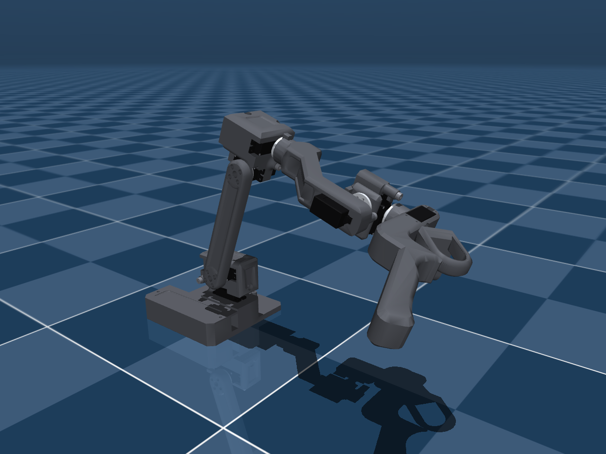

# RAFT models: getting started

[All models](https://github.com/Source-Robotics/robot_descriptions/blob/ff2bdf30ef9a5e87f86c7eb7ad3ca90ef195f210/README.md) | [PAR6](https://github.com/Source-Robotics/robot_descriptions/blob/ff2bdf30ef9a5e87f86c7eb7ad3ca90ef195f210/guides/par6.md) | [Change colors](https://github.com/Source-Robotics/robot_descriptions/blob/ff2bdf30ef9a5e87f86c7eb7ad3ca90ef195f210/docs/COLORS.md) | [License and attribution](https://github.com/Source-Robotics/robot_descriptions/blob/ff2bdf30ef9a5e87f86c7eb7ad3ca90ef195f210/ATTRIBUTION.md)

RAFT is the teleoperation leader arm for PAR6: PAR6's kinematic structure at 5/9 scale, with a trigger on its handle
that drives the follower's gripper. It is available in **MuJoCo and URDF**, in one configuration: the arm with its
handle and trigger.

To customize appearance, edit the [shared color file](https://github.com/Source-Robotics/robot_descriptions/blob/ff2bdf30ef9a5e87f86c7eb7ad3ca90ef195f210/source/appearance/colors.json) (`raft_structure`,
`raft_trigger`, `raft_horns`, `raft_fasteners`; the servos follow `motors`, or the `raft_motors` override) and
follow the [illustrated color guide](https://github.com/Source-Robotics/robot_descriptions/blob/ff2bdf30ef9a5e87f86c7eb7ad3ca90ef195f210/docs/COLORS.md). One palette covers both formats and all tools.



## 1. Download

- **MuJoCo:** [download raft_mujoco.zip](https://github.com/Source-Robotics/robot_descriptions/releases/latest/download/raft_mujoco.zip), then extract the `raft/` folder.
- **URDF:** [download raft_urdf.zip](https://github.com/Source-Robotics/robot_descriptions/releases/latest/download/raft_urdf.zip), then extract the `raft_description/` folder.

Keep each extracted folder intact; the model files use relative paths to their meshes. No CAD tools or source build
are needed to use these downloads.

| Format | Entry file |
| --- | --- |
| MuJoCo | [`scene.xml`](https://github.com/Source-Robotics/robot_descriptions/blob/ff2bdf30ef9a5e87f86c7eb7ad3ca90ef195f210/mujoco/raft/scene.xml) to look at it, [`raft.xml`](https://github.com/Source-Robotics/robot_descriptions/blob/ff2bdf30ef9a5e87f86c7eb7ad3ca90ef195f210/mujoco/raft/raft.xml) to put it into another MuJoCo world |
| URDF | [`raft.urdf`](https://github.com/Source-Robotics/robot_descriptions/blob/ff2bdf30ef9a5e87f86c7eb7ad3ca90ef195f210/urdf/raft_description/raft.urdf) |

## 2. Open the model

**MuJoCo:** with the Python MuJoCo package installed, run this from the directory where you extracted the ZIP:

```bash
python -m mujoco.viewer --mjcf=raft/scene.xml
```

For a checkout of the central `robot_descriptions` repository, run this from its root:

```bash
python -m mujoco.viewer --mjcf=mujoco/raft/scene.xml
```

The hardware repository's `raft_description/` folder contains this guide and previews. Extract the model download
into a separate working directory or ROS workspace to use the actual model package.

**URDF viewer:** open `raft_description/raft.urdf`, keeping the `meshes/` directory alongside it.

**ROS 2 / RViz:** install the extracted `raft_description` package with colcon using
[the ROS 2 guide](https://github.com/Source-Robotics/robot_descriptions/blob/ff2bdf30ef9a5e87f86c7eb7ad3ca90ef195f210/docs/ROS2.md), source your workspace, then run:

```bash
ros2 launch raft_description display.launch.py
```

This opens RViz and joint sliders. ROS 1 retains `roslaunch raft_description display.launch`.

## 3. Joints, actuators and the trigger

The joints are named like PAR6's: `base_joint`, `shoulder_joint`, `elbow_joint`, `wrist_1_joint`, `wrist_2_joint`,
`wrist_3_joint`, plus `trigger_joint`. `q = 0` is the standby pose, PAR6's standby pose, so RAFT's joint angles map
one to one onto PAR6's. `tcp` is the tool point on the handle.

The MuJoCo actuators (`<joint>_actuator`) take joint torque in Nm, as RAFT's servos run in current mode. The tendon
`j2_spring` models the optional J2 counterbalance; its stiffness 0 means no spring is fitted.

## 4. Check dimensions and frames

- [RAFT DH convention](https://github.com/Source-Robotics/robot_descriptions/blob/ff2bdf30ef9a5e87f86c7eb7ad3ca90ef195f210/mujoco/raft/docs/DH.md)
- [RAFT and PAR6: the 5/9 scale](https://github.com/Source-Robotics/robot_descriptions/blob/ff2bdf30ef9a5e87f86c7eb7ad3ca90ef195f210/mujoco/raft/docs/KINEMATICS_COMPARISON.md)
- [Joint ranges and where they come from](https://github.com/Source-Robotics/robot_descriptions/blob/ff2bdf30ef9a5e87f86c7eb7ad3ca90ef195f210/mujoco/raft/docs/JOINT_LIMITS.md)
- [Masses, centres of mass and inertias](https://github.com/Source-Robotics/robot_descriptions/blob/ff2bdf30ef9a5e87f86c7eb7ad3ca90ef195f210/mujoco/raft/docs/DYNAMICS.md)
- [Actuation and the J2 counterbalance](https://github.com/Source-Robotics/robot_descriptions/blob/ff2bdf30ef9a5e87f86c7eb7ad3ca90ef195f210/mujoco/raft/docs/ACTUATION.md)

One end of every joint range is a mechanical stop measured on the first arm; the masses come from the CAD; the
servos' friction, damping and rotor inertia are estimates.

## The arm itself

RAFT's parts, BOM, assembly manual and ESP32 firmware are in the
[RAFT repository](https://github.com/Source-Robotics/RAFT-teleoperation-arm). Its firmware computes gravity
compensation from the same model reference these packages are built from
([`source/raft/`](https://github.com/Source-Robotics/robot_descriptions/blob/ff2bdf30ef9a5e87f86c7eb7ad3ca90ef195f210/source/raft/README.md)).

## Maintained model source

This folder contains the product guide and preview images. Download the runtime
model packages using the links above and extract them into your working directory.
All model files are maintained in [robot_descriptions](https://github.com/Source-Robotics/robot_descriptions);
this hardware repository has no model submodule to initialize.

Current tested model release: **[v2.18.1](https://github.com/Source-Robotics/robot_descriptions/releases/tag/v2.18.1)**.
See the [shared product guide](https://github.com/Source-Robotics/robot_descriptions/blob/ff2bdf30ef9a5e87f86c7eb7ad3ca90ef195f210/guides/raft.md)
for the corresponding central documentation.
